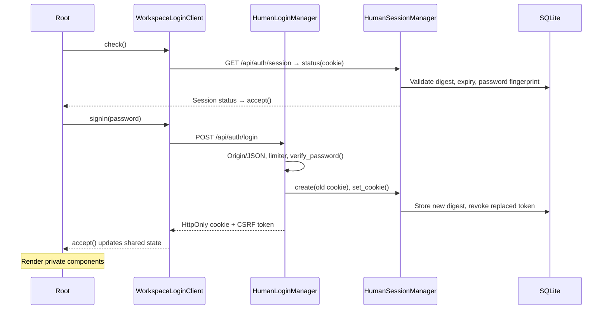

# Login and session workflow

Workspace login opens the human tracker UI. Google consent links one account for
Gmail/Drive capabilities. External ChatGPT and Claude clients authenticate with
the existing agent token. These are three independent lifecycles.

Local mode requires no workspace password and restricts human access to the local
machine. Hosted mode requires the configured workspace password and HTTPS
(loopback HTTP is allowed for development).
Google connection is available after workspace access; it does not log a person
into the tracker or replace the agent token.

## Ownership and reuse

The framework-independent core is now `backend/app/session_manager.py`:
`SessionManager(SessionStore, credential_binding, lifetime=..., capacity=...,
clock=...)`. It imports only the Python standard library. Stores implement
`load`, atomic `replace` (prune/revoke/insert), and `revoke`; persisted grants
contain a token digest, credential-version binding, creation and expiry times.
`SqlHumanSessionStore` is the tracker adapter. `HumanSessionManager` retains the
existing cookie/CSRF-facing interface, with no change to agent authentication.

For authorized provider APIs, reuse `backend/app/authorized_api.py`:
`AuthorizedApiClient(base_url, acquire, request, rejected)`. `acquire(capability)`
returns `TokenLease(token, generation)`; `rejected` receives only actual
authorization failures and must check the generation before invalidating a
stored grant. Rate-limit/storage/server errors preserve the credential. The
client never retries writes automatically. The HTTP/store adapters remain host
choices, and tokens are absent from errors and diagnostic representations.

Independent in-memory adapter examples and tests live in
`backend/tests/auth/test_session_manager.py` and `test_authorized_api.py`.

| Class | Responsibility | Shared consumers |
| --- | --- | --- |
| `BrowserSessionManager` (`frontend/src/auth.ts`) | Reactive session state, CSRF headers, expiry, stale-response protection | Root, API client, event stream |
| `WorkspaceLoginClient` (`frontend/src/auth.ts`) | Session-check, password-login and logout HTTP calls | Root and event-stream recovery |
| `HumanSessionManager` (`backend/app/human_auth.py`) | Persist, validate, replace and revoke workspace sessions; set/delete cookies | Auth routes, request policy, SSE, Google callback |
| `HumanLoginManager` (`backend/app/human_auth.py`) | Verify password attempts and orchestrate login/logout | Thin auth routes |
| `LoginAttemptLimiter` (`backend/app/human_auth.py`) | Persistent attempt limits | Human login manager |
| `HumanAccessPolicy` (`backend/app/human_auth.py`) | Transport, loopback, origin, session and CSRF checks | Middleware and connection routes |
| `GoogleLoginClient` (`frontend/src/googleAuth.ts`) | Connection status, authorization URL validation and disconnect calls | Google settings; reusable by other components |
| `GoogleLoginManager` (`backend/app/google_login.py`) | Google consent, code exchange, identity/grant validation and saving | Google connection facade |
| `OAuthSessionManager[T]` (`backend/app/oauth_sessions.py`) | Bounded, expiring, single-use browser/owner-bound pending flows | Google login; reusable by another provider |
| `GoogleConnection` (`backend/app/google_connection.py`) | Linked-account status, credential refresh, capability checks and API access | Google login, Gmail/Drive providers, REST/MCP |
| `NativeSecretStore` (`backend/app/google_connection.py`) | Read/write/delete credentials using an approved native OS store | Google connection/login |

The backend constructs one set of managers per application during `lifespan` and
exposes them through `app.state.human_sessions`, `human_login`, `human_access` and
`google.login`. Managers can be instantiated with the same database to share
persistent sessions. OAuth pending state is process-local: restarting the server
requires restarting incomplete consent, while completed connections survive.

The frontend exports `browserSession`, `workspaceLogin`, and `googleLogin` shared
instances. Existing function exports delegate to those instances for compatibility.
Components should import the instances instead of creating their own session state:

```ts
import { browserSession, workspaceLogin } from './auth'
const session = browserSession.state
await workspaceLogin.check()
// A logout button can call workspaceLogin.signOut().
// A request client can call browserSession.withHeaders(options).
```

Tests and alternate hosts may construct `WorkspaceLoginClient(sessions, fetch)`
with a test transport. Backend login accepts injected session/limiter/password
verification services; OAuth sessions accept an injected clock.

## Workspace login, function by function



| Order | Function | What it does |
| --- | --- | --- |
| 1 | `Root.onMounted` → `WorkspaceLoginClient.check()` | Hold private components while asking the backend for the current session. Preserve the requested URL hash. |
| 2 | `WorkspaceLoginClient.authRequest()` | Send same-origin, uncached auth requests with an eight-second timeout; turn backend failures into readable errors. |
| 3 | `human_session()` → `HumanSessionManager.status()` | Return local-mode access, or validate the hosted cookie and return authentication plus a CSRF token. |
| 4 | `HumanSessionManager.is_authenticated()` | Bound token length, hash the opaque cookie, then delegate to reference validation. |
| 5 | `HumanSessionManager.is_authenticated_reference()` | Read the stored digest and check expiry and password fingerprint. The same method validates the initiating owner of a pending Google flow. |
| 6 | `BrowserSessionManager.accept()` | Validate the response, update the shared reactive state, and ignore an obsolete response revision. The root renders the app only after authentication succeeds. |
| 7 | `Root.login()` → `WorkspaceLoginClient.signIn(password)` | Submit the password, start a new response revision, and accept the result. The root clears its password field on success; the client retains no password. |
| 8 | `human_login()` → `HumanLoginManager.sign_in()` | Require hosted mode, correct Origin and JSON; apply persistent rate limits; bound concurrent password checks to two. |
| 9 | `LoginAttemptLimiter.record()` | Count attempts transactionally for the address and workspace. Limits are ten per address and 100 per workspace in 15 minutes; counters survive restart. |
| 10 | `verify_password()` | Verify the configured scrypt hash with constant-time digest comparison. `validate_password_hash()` checks its format and parameters. |
| 11 | `HumanSessionManager.create(old_token)` | Generate a random opaque token; delete expired sessions and the replaced token; retain at most 20 sessions; persist only its digest, expiry and password fingerprint. |
| 12 | `HumanSessionManager.set_cookie()` | Set `__Host-tracker-session`, Secure, HttpOnly, SameSite=Strict, Path=/, with the configured session duration (default eight hours). JavaScript cannot read this cookie. |
| 13 | `csrf_token()` | Derive a separate CSRF value, returned in the login/session response and held only in frontend memory. |

`hash_password()` and `password_cli()` provision the configured password hash;
they are setup utilities, outside the browser request flow. `digest()` is the
shared SHA-256 helper, and `fingerprint()` binds sessions to the configured hash.

## Requests, expiry and logout

| Function | Responsibility |
| --- | --- |
| `protect_human_routes()` → `HumanAccessPolicy.authorize()` | Apply the common request policy. Hosted private API requests require a fresh session check; writes also require matching Origin and CSRF. Agent routes retain their separate bearer-token authorization. |
| `check_transport()` / `require_origin()` | Check the configured address/HTTPS and exact request origin. Forwarded headers cannot bypass these checks without explicitly trusted proxy configuration. |
| `HumanAccessPolicy.require_local()` | Enforce loopback human access in local mode. |
| `BrowserSessionManager.withHeaders()` | Add the current CSRF token to writes without changing multipart content types. |
| `BrowserSessionManager.expire()` | Clear authentication/CSRF, invalidate outstanding response revisions, and show the sign-in UI. Called on API 401 or the event stream's `auth.expired`. |
| `WorkspaceLoginClient.check()` | Recheck on event-stream errors. Errors remain visible; a failed check does not invent a successful login. |
| `BrowserSessionManager.snapshot()` / `beginTransition()` / `isCurrent()` | Prevent delayed checks from restoring a logged-out/expired session or overwriting a newer login. |
| `WorkspaceLoginClient.signOut()` | Send a CSRF-protected logout request and require explicit server acknowledgement before clearing UI state. |
| `human_logout()` → `HumanLoginManager.sign_out()` | Revoke the hosted session and delete the browser cookie. |
| `HumanSessionManager.revoke()` / `clear_cookie()` | Delete the stored session digest and expire the cookie using its original attributes. |
| `BrowserSessionManager.confirmSignOut()` | Clear local state and invalidate outstanding checks after confirmed logout. |

Database expiry, explicit logout, password-hash changes and session replacement
all invalidate access. SSE also checks the session while streaming, rather than
trusting its initial connection indefinitely. Workspace logout does not disconnect
the shared Google account or rotate the agent token.

## Google connection, function by function

| Order | Function | What it does |
| --- | --- | --- |
| 1 | `GoogleLoginClient.status()` | Read safe connection metadata and granted capabilities for the UI. |
| 2 | `GoogleSettings.connect()` → `GoogleLoginClient.authorizationUrl()` | Start the requested capabilities, validate the Google authorization origin/path, and let the component navigate the browser. |
| 3 | `google_human()` → `HumanAccessPolicy.connection_owner()` | Enforce the workspace address and action Origin; identify the initiating workspace-session digest (or local-mode identity). Middleware separately protects the start/disconnect actions. |
| 4 | `google_start()` → `GoogleConnection.start()` → `GoogleLoginManager.start()` | Check configuration/capabilities and native credential-store availability; snapshot linked-account identity and connection generation; generate PKCE and nonce. |
| 5 | `OAuthSessionManager.create()` | Generate a state value and hold hashed state/browser binding plus owner and provider claims for ten minutes. Limit pending flows to 20. The route sets a temporary HttpOnly SameSite=Lax browser-link cookie. |
| 6 | Google consent | The person chooses an account and grants capabilities. Google redirects to the configured callback with an authorization code and state. |
| 7 | `google_callback()` → `GoogleConnection.finish()` → `GoogleLoginManager.finish()` | Orchestrate callback verification and exchange; redirect to settings only after success. |
| 8 | `OAuthSessionManager.consume()` | Check expiry, browser binding, owner and one-time use. In hosted mode, also check the server-held initiating workspace session is still valid. Consume atomically before exchanging the code. |
| 9 | `GoogleLoginManager._exchange_code()` | Exchange the authorization code and original PKCE verifier using the backend's configured client. No token is exposed to the frontend. |
| 10 | `GoogleLoginManager._validate_grant()` → `verify_identity()` | Verify the signed ID token, issuer, audience, subject, verified email and nonce. Enforce the pinned account; intersect requested/granted scopes; require offline refresh access. |
| 11 | `GoogleLoginManager._persist_connection()` | Reject a stale connection generation or changed account. Store tokens through `NativeSecretStore.put()` and safe metadata in SQLite; remove replaced OS credentials. |
| 12 | `GoogleConnection.status()` | Return the linked email, connection health and independent granted capabilities; handle unavailable OS credentials without exposing secrets. |
| 13 | `GoogleConnection.access_token()` | Load native credentials and refresh an expiring access token under a database transaction. Mark revoked credentials for reconnect and respect narrower scopes. |
| 14 | `GoogleConnection.api()` | Check capability, call Google with the backend-held token and update verification/revocation state. Gmail and Drive providers share this path. |
| 15 | `GoogleLoginClient.disconnect()` → `GoogleConnection.disconnect()` | Delete OS credentials, clear linked metadata/scopes, increment generation and clear pending OAuth sessions. Workspace sessions and agent credentials keep their own lifecycles. |

The Google callback is the sole connection route allowed through the hosted
session-cookie gate. Browsers omit a SameSite=Strict workspace cookie on a
cross-site return from Google. The callback instead requires its short-lived
Lax browser-link cookie, random one-time state and a still-active initiating
workspace session held server-side. If a workspace cookie is present, its owner
must match too. Logout, expiry, password change, another browser/session and replay
all reject the callback. Ordinary API routes still require the Strict cookie.
See [MDN's SameSite cookie behavior](https://developer.mozilla.org/en-US/docs/Web/HTTP/Reference/Headers/Set-Cookie)
and [Google's web-server OAuth flow](https://developers.google.com/identity/protocols/oauth2/web-server).

## State locations

| State | Location | Lifetime |
| --- | --- | --- |
| Workspace password | Form/request only; configured scrypt hash on server | Password cleared from form on successful sign-in |
| Opaque workspace token | HttpOnly browser cookie | Configured session duration/logout |
| Session digest, expiry, password fingerprint | SQLite `human_sessions` | Revocation/expiry/pruning |
| CSRF and frontend authentication status | Shared reactive memory | Reload, expiry or logout |
| OAuth state digest, browser binding, owner, nonce, PKCE verifier | Backend pending-session memory | Ten minutes, successful consumption, disconnect or restart |
| Google access/refresh tokens | Native OS credential store | Refresh, replacement, disconnect or revocation |
| Google subject/email/scopes/health | SQLite connection metadata | Reconnect/disconnect |
| Agent authority | Existing single agent principal and permission model | Rotation/revocation; independent of workspace/Google login |

## Verification

Offline regressions cover the existing workspace login/CSRF/expiry behavior,
session-manager reuse, callback state/binding/identity checks, cross-site callback
without the Strict cookie, revoked/expired/password-changed initiating sessions,
concurrent one-time consumption, and stale frontend responses after logout/expiry.
The normal test gate includes these tests and the production type-check/build.
The full pre-push gate on 20 October 2026 passed against the exact staged snapshot:
462 backend/tooling tests and 112 frontend tests, with the real Google smoke
skipped. Production build/type-check, dependency consistency and official
PrimeVue MCP validation (66 component usages, none needing review) also passed.

A browser check against an isolated hosted-mode loopback workspace verified
incorrect-password feedback, successful login to the original Settings route,
session persistence after reload, and private UI removal after confirmed logout.

Real Google consent remains a separate manual check, as requested. Follow
`GOOGLE_INTEGRATION.md` for setup and the live checklist. Specifically verify a
hosted HTTPS browser redirect succeeds, returning after workspace logout fails,
and the browser cannot replay a completed callback. Do not enter secrets in chat.
